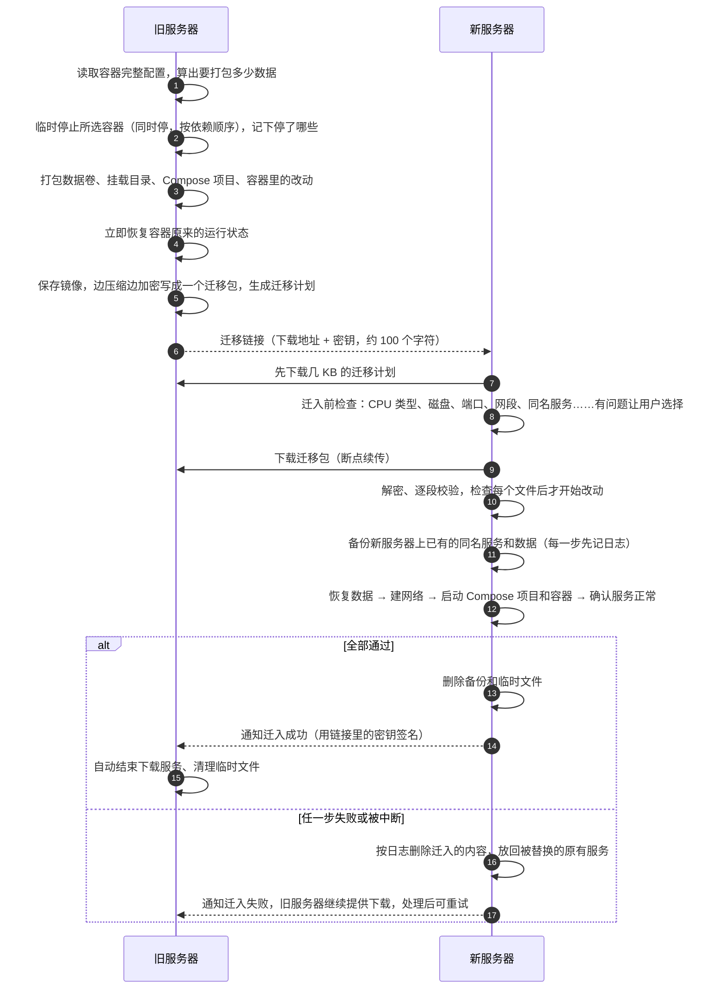

<div align="center">

<picture>
  <source media="(prefers-color-scheme: dark)" srcset="docs/images/logo-dark.png">
  
</picture>

**一条链接，把 Docker 服务连同数据从旧服务器迁到新服务器。**

镜像、数据卷、挂载目录、端口、环境变量、网络、Compose 项目，连容器里没挂载出来的改动也一起迁移；
全程加密传输、边下载边校验，迁入失败或被中断都会自动删除迁入的内容，新服务器回到迁入前的样子。

[](https://github.com/lx969788249/dockhop/actions/workflows/ci.yml)
[](https://github.com/lx969788249/dockhop/actions/workflows/apps.yml)
[](https://github.com/lx969788249/dockhop/releases/latest)
[](https://github.com/lx969788249/dockhop/stargazers)


[快速开始](#-快速开始) · [功能特性](#-功能特性) · [迁移范围](#-迁移范围) · [工作原理](#-工作原理) · [高级用法](#-高级用法) · [常见问题](#-常见问题)

</div>

---

## ✨ 为什么需要它

换服务器时最怕的不是“怎么搬”，而是“搬漏了什么”：

- 当初 `docker run` 的端口、环境变量、重启策略、资源限制还记得吗？
- 数据卷和宿主机挂载目录有没有漏掉？权限和属主对不对？
- 进容器里改过的配置文件，没挂载出来，还能带走吗？
- 搬到一半失败了，新服务器会不会变成半成品？

DockHop 直接读取容器的完整配置，原样交给新服务器的 Docker 重建，再把所有数据打成一个加密迁移包。新服务器粘贴链接后，先检查能不能迁入，再下载、恢复、逐个确认服务正常；任何一步失败都会删除这次迁入的内容、把被替换的原有服务放回去，不会留下半成品。

## 🚀 快速开始

在**旧服务器**和**新服务器**上运行同一条命令：

```bash
bash <(curl -fsSL dockhop.run)
```

| 步骤 | 在哪里 | 做什么 |
|:---:|---|---|
| 1 | 旧服务器 | 选择 `1) 迁出`，选要迁移的服务（Compose 项目里的容器一起迁移） |
| 2 | 旧服务器 | 复制显示出来的迁移链接。**这个窗口不要关**，新服务器要从这里下载数据 |
| 3 | 新服务器 | 选择 `2) 迁入`，粘贴链接，自动完成检查、下载和迁入 |
| 4 | 旧服务器 | 新服务器迁入成功后，旧服务器这边自动结束、清理临时文件 |

也可以直接带上命令，跳过菜单：在旧服务器 `bash <(curl -fsSL dockhop.run) out`，在新服务器 `bash <(curl -fsSL dockhop.run) in '迁移链接'`。

> [!WARNING]
> 迁移链接里包含解开这次迁移包的密钥。请完整复制，只通过可信的渠道发送，不要公开。

> [!TIP]
> 新服务器连不上时，最常见的原因是旧服务器的防火墙或云厂商安全组没有放行下载端口（默认 8080）。DockHop 会在几秒内说明是哪种情况、该放行哪个端口。

## 🧩 功能特性

<table>
<tr>
<td width="50%" valign="top">

### 📦 完整迁移
- 容器配置**原样搬运**：直接把源容器的完整配置交给新服务器的 Docker 创建，端口、环境变量、启动命令、重启策略、资源限制、健康检查、能力、ulimit、tmpfs、DNS……一项不翻译、一项不漏，连 DockHop 不认识的新字段也照样带过去
- 数据卷和宿主机挂载目录连同属主、权限、软链接一起迁移，匿名卷的数据也不丢
- 容器里**没挂载出来的改动**：只迁移改动过的文件，容器的镜像名不变，以后照常升级
- Docker Compose 项目整组迁移：整个项目目录、目录外引用的文件（如 `env_file`），用原来的文件、原来的 `-f` 写法和项目名启动，迁移后照常 `docker compose up -d`
- 自定义网络连同网段、网关、固定 IP、别名一起重建
- 运行、暂停、停止状态原样保留

</td>
<td width="50%" valign="top">

### 🔒 安全传输
- 迁移包用开源加密库 [age](https://github.com/FiloSottile/age) 加密，每 64KB 一段、每段都带校验，能发现内容被改、被截断或顺序被调换
- 密钥只在链接 `#` 后面，浏览器和下载工具都不会把它发给服务器；下载地址带随机口令
- 边打包边压缩边加密，旧服务器上不留明文的中间文件
- 迁入前检查迁移包里的每一个文件：路径越界、通过软链接写到别处的内容一律拒绝，而且是在改动任何东西之前

</td>
</tr>
<tr>
<td width="50%" valign="top">

### 🛡️ 失败自动删除
- 迁入以**事务**方式进行：每一处改动都先记进日志再动手；新服务器上已有的同名容器、Compose 项目、数据卷、目录都先备份
- 任何一步失败（服务起不来、健康检查不通过、按 Ctrl+C），都按日志删除这次迁入的内容，被替换的原有服务放回原处
- 一次迁多个服务、只有一部分起不来时，可以选择全部删除（推荐），或者只删除起不来的、保留已经正常运行的；之后用同一个链接重新迁入，已经迁入的会跳过
- 程序被强制结束（`kill -9`、断电）也不怕：下次运行迁入时会提示删除上次没完成的迁入
- 旧服务器只在打包数据时短暂停机，打包完立即恢复；停机期间被强制结束，下次运行迁出时会把容器恢复原状

</td>
<td width="50%" valign="top">

### 🧠 省心
- 只依赖 Docker：一个静态编译的程序，不往系统里装 jq、python3 之类的软件
- **下载之前先检查**：CPU 类型、磁盘空间、端口占用、网段冲突、固定 IP、同名服务、显卡、按摘要固定版本的镜像……有问题当场让你选择怎么处理（例如自动换一个空闲端口）
- 停机前先算出要打包多少数据，容器里改动特别大时提前提醒
- 下载断了自动从断点继续；两台服务器网络不通时，可以把迁移包用别的方式带过去
- 新服务器迁入成功后，旧服务器自动结束
- 在 Docker 20.10 到 29 之间互相迁移都经过测试
- 全部提示都是大白话

</td>
</tr>
</table>

## 📋 迁移范围

| 内容 | 是否迁移 | 说明 |
|---|:---:|---|
| 镜像 | ✅ | 随迁移包传输，新服务器不用联网拉取 |
| 数据卷（volume） | ✅ | 包括驱动、参数和标签；匿名卷的数据也迁移 |
| 宿主机挂载目录 / 文件（bind） | ✅ | 恢复到原路径；挂载的是软链接时，在原路径重建软链接 |
| 容器里没挂载出来的改动 | ✅ | 只迁移改动过的文件，镜像名不变 |
| 端口、环境变量、命令、重启策略、资源限制、健康检查等 | ✅ | 原样搬运，详见[功能特性](#-功能特性) |
| 自定义网络、固定 IP、网络别名 | ✅ | 动态分配的 IP 不会被固定 |
| Docker Compose 项目 | ✅ | 整个项目目录和目录外引用的文件，恢复到原路径 |
| 按摘要固定版本的镜像（`镜像@sha256:…`） | ✅ | 新服务器连得上镜像仓库时补齐摘要；连不上时询问是否改用迁移包里的镜像 |
| 运行 / 暂停 / 停止状态 | ✅ | |
| `/etc/localtime`、`/proc`、`/sys`、`/dev` 等系统路径 | ↪️ | 只在新服务器重建挂载关系，不覆盖新服务器的系统文件 |
| Docker socket（`/var/run/docker.sock`） | ↪️ | 同上，挂载关系保留，指向新服务器自己的 Docker |
| 宿主机上的 Nginx、证书、crontab 等 | ❌ | 不属于容器，请自己迁移 |
| Swarm 服务创建的容器 | ❌ | 菜单里会标出来 |
| 不同 CPU 架构之间迁移（如 ARM → x86） | ❌ | 镜像和架构绑定，请在相同架构的服务器之间迁移 |
| 运行中进程的内存状态 | ❌ | 容器会在新服务器上重新启动 |

## 🔍 工作原理



## 🆚 与常见做法对比

| | 手动 `docker save` + `scp` | 由容器反推 `docker run` 的工具 | 数据卷备份工具 | **DockHop** |
|---|:---:|:---:|:---:|:---:|
| 镜像 | ✅ | ❌ | ❌ | ✅ |
| 运行参数（端口、环境变量等） | 手动记录 | 部分（翻译容易漏） | ❌ | ✅ 原样搬运 |
| 数据卷与挂载目录 | 手动打包 | ❌ | ✅ | ✅ |
| 容器里没挂载出来的改动 | ❌ | ❌ | ❌ | ✅ |
| Compose 项目、自定义网络 | 手动 | 部分 | ❌ | ✅ |
| 迁入前检查端口、磁盘等 | ❌ | ❌ | ❌ | ✅ |
| 加密传输与校验 | ❌ | ❌ | 部分 | ✅ |
| 失败自动删除、回到迁入前 | ❌ | ❌ | ❌ | ✅ |
| 操作步骤 | 多步手工 | 多步手工 | 多步手工 | **复制一条链接** |

## 🔧 高级用法

### 命令

下面用 `dockhop` 代表程序。通过一行命令运行时，把参数接在后面即可，例如 `bash <(curl -fsSL dockhop.run) out --include web,db`。

```bash
# 只迁移指定的容器（或它们所在的 Compose 项目），不显示菜单
dockhop out --include nginx,mysql

# 不停机打包（数据库等正在写入的数据可能不一致，谨慎使用）
dockhop out --no-stop

# 在新服务器直接迁入
dockhop in 'http://…完整链接…'

# 不提问：检查发现的问题自动采用推荐做法（例如自动换一个空闲端口）
dockhop in --yes 'http://…完整链接…'

# 两台服务器网络不通：把迁移包用 scp、网盘等带过来，再用同一个链接迁入
dockhop in --file /root/bundle 'http://…完整链接…'

# 只做迁入前检查，不下载、不改动任何东西
dockhop check 'http://…完整链接…'

# 在屏幕上显示每一步的细节（默认只写进日志）
dockhop out -v

# 出问题时收集诊断信息，生成一个可以附到 Issue 里的文件
dockhop diagnose
```

在没有终端的环境（定时任务、`nohup`）里迁出时，下载服务会一直运行，并提示一条 `kill -TERM <进程号>` 命令；新服务器迁入成功后它也会自动结束。

### 选项

| 选项 | 默认 | 说明 |
|---|---|---|
| `out --include a,b` | 显示菜单 | 只迁移这些容器（或它们所在的 Compose 项目） |
| `out --no-stop` | 停机打包 | 不停机打包 |
| `out --stop-shared` | 询问 | 不能提问时，允许临时停止和所选容器共用数据或网络的其他容器（打包完自动恢复） |
| `out --snapshot auto\|always\|never` | `auto` | 容器里没挂载出来的改动：有改动才迁移 / 连运行时临时目录也迁移 / 不迁移 |
| `out --port 端口` | `8080` | 下载服务的端口，被占用时自动往后找 |
| `out --host 地址` | 自动探测 | 链接里使用的公网 IP 或域名（NAT、多网卡或探测不准时设置） |
| `out --workdir 目录` | `~/.dockhop/work` | 存放迁移包的目录 |
| `in --file 迁移包` | 下载 | 用别的方式带过来的迁移包 |
| `in --yes` | 询问 | 不能提问时，检查发现的问题自动采用推荐做法；没法自动处理的仍会停下 |
| `in --existing replace\|skip\|fail` | 询问 | 新服务器已有同名服务时：替换（失败时放回原来的）/ 保留已有的 / 停止 |
| `in --skip-check` | 检查 | 跳过迁入前检查 |
| `in --health-timeout 秒` | `60` | 健康检查至少等多久（会按容器自己的检查间隔自动加长） |
| `in --keep-files` | 删除 | 迁入成功后保留下载和解开的文件 |
| `in --keep-succeeded` | 全部删除 | 有服务没能启动时，不提问，保留已经正常运行的、只删除没启动的 |

### 环境变量

| 变量 | 默认值 | 说明 |
|---|---|---|
| `DOCKHOP_HOME` | `~/.dockhop` | 日志（`logs/`）、中断记录（`state/`）、回滚资料（`rollback/`）和工作文件（`work/`）都放在这里 |
| `DOCKHOP_KEEP_LOG` | — | 设为 `1` 时，成功后也保留日志 |
| `DOCKHOP_MIRROR` | dockhop.run，不行时 GitHub Releases | 一行命令下载程序用的镜像站（设置后只用它）；程序的校验值写在 `run.sh` 里，从镜像站下载也能确认没被改动 |

完整说明见 `dockhop --help`。

## 💻 系统要求

- Linux 服务器，x86_64、arm64 或 armv7，用 root 运行
- Docker 20.10 或更新的版本
- 迁移 Compose 项目时，新服务器需要 `docker compose`；只有老的 docker-compose 1.x 时，有些新写法读不懂，迁入前检查会提醒，建议先装新版
- 一行命令需要 `curl`（或 `wget`）和 `sha256sum`，除此之外不需要任何其他软件
- 旧服务器对新服务器开放一个 TCP 端口（默认 8080）；实在开放不了，可以用 `--file` 把迁移包带过去

## ❓ 常见问题

<details>
<summary><b>新服务器连不上 / 连接超时</b></summary>

新服务器第一步就会连旧服务器，连不上时几秒内就说明是哪种情况，不会傻等：

- **连接超时**：几乎都是端口没有放行，先检查云厂商控制台的安全组，再检查旧服务器的防火墙。
- **拒绝连接**：旧服务器上的迁出可能已经结束（窗口关了，或者输入 q 结束了），或者防火墙拒绝了这个端口。
- **找不到这次迁移**：旧服务器上的迁出已经结束或重新运行过，请用新的链接。

处理方法：

1. 在旧服务器放行下载端口，例如 `ufw allow 8080/tcp` 或 `firewall-cmd --add-port=8080/tcp`，迁完再关掉。
2. 在云厂商控制台的安全组里也放行这个端口。
3. 链接里的 IP 不对（NAT、内网、多网卡）时，用 `out --host 公网IP` 重新迁出。

放行之后用同一个链接重新运行迁入即可。
</details>

<details>
<summary><b>迁入前检查会检查什么？发现问题怎么办？</b></summary>

粘贴链接后，DockHop 先下载一份几 KB 的“迁移计划”，在下载迁移包之前检查新服务器：

- **只提醒、不停下**：Docker 版本比旧服务器旧、容器内存上限合计超过本机内存、新服务器只有老的 docker-compose 等。
- **停下来让你选择**：端口被占用（自动换一个空闲端口、手动输入端口、不对外开放，或先处理再重新检查）、已有同名容器或 Compose 项目（替换或保留）、网段冲突或固定 IP 被占用（改为自动分配）、端口绑定的地址在新服务器上不存在（改绑到所有地址）、按摘要固定的镜像拉不到（改用迁移包里的）、磁盘空间不够等。Compose 项目的端口写在你自己的文件里，DockHop 不替你改，可以先自己修改，或暂时跳过这个项目。
- **无法继续**：两台服务器的 CPU 类型不同、缺少显卡运行环境或卷插件等。

所有调整都会列在最后的结果里，例如“端口变更：web 80 → 8081”。想在正式迁移前先看一遍，可以用 `dockhop check '链接'`。
</details>

<details>
<summary><b>迁移会让旧服务器停机多久？</b></summary>

只在打包数据时停机：所选容器同时停止，打包数据卷、挂载目录和容器里的改动，打包完立即恢复运行。后面的保存镜像、加密和新服务器下载都不影响旧服务器上的服务。

停机多久主要看数据量和磁盘速度。实测：几 MB 的服务不到 1 秒，几十到几百 MB 的数据库三四十秒。停机前会显示要打包多少数据；容器里没挂载出来的改动特别大时（例如积攒了大量日志、崩溃转储），会提前提醒，你可以先清理再迁出。
</details>

<details>
<summary><b>迁入失败了怎么办？新服务器会不会被搞乱？</b></summary>

不会。迁入时的每一处改动都先记进日志，失败或按 Ctrl+C 时按日志倒着撤销：本次新建的容器、网络、数据被删除，被替换的同名容器（连同它的网络和固定 IP）、Compose 项目、数据卷、挂载目录放回原处，新服务器回到迁入前的样子。

开始改动之前，还会先用新服务器上的 Docker Compose 把每个项目的配置文件读一遍，读不懂（例如老版本 docker-compose 不认识新写法）就直接停下，什么都不改。

处理好问题（例如端口冲突）后重新运行即可，下载好的迁移包会保留，不用重新下载。解密出来的数据在失败时一律删除，磁盘上不留明文。
</details>

<details>
<summary><b>一次迁了好几个服务，只有一个起不来，其他的也要删掉吗？</b></summary>

DockHop 会把有关联的服务分成一组（同一个 Compose 项目，或者共用数据卷、目录、网络、互相依赖的容器），一组起不来时，其他组照常启动，然后问你怎么处理：

1. **全部删除（推荐）**：新服务器回到迁入前的样子，环境最干净。处理好问题后用同一个链接重新迁入即可。
2. **只删除起不来的，保留已经运行的**：代价是新服务器上只有一部分服务；如果已经运行的服务要用到起不来的（例如网站连数据库），它们看起来在运行，实际可能用不了。起不来的服务以后用同一个链接再迁一次，已经迁入的会跳过；如果最后决定不迁了，保留下来的服务要自己手动删除。

不能提问时（`--yes`、定时任务）默认全部删除，想保留已经运行的服务可以加 `--keep-succeeded`。
</details>

<details>
<summary><b>迁入到一半，程序被强制结束了怎么办？</b></summary>

例如被 `kill -9`、内存不够被系统结束、断电。改动记录在磁盘上，下次运行迁入时会提示“上次迁入没有完成就被结束了，新服务器上还留着它的 N 处改动”，选择删除即可回到迁入前的样子。旧服务器同理：停机期间被强制结束，下次运行迁出时会提示，并把停下的容器恢复原状。
</details>

<details>
<summary><b>为什么迁过去后，有的容器镜像名变成了 <code>dockhop-image:…</code>？</b></summary>

只有两种情况会这样：

- 容器里**删除过**镜像自带的文件：为了让删除也生效，DockHop 在新服务器上做了一个带改动的镜像。只新增、修改过文件的容器，镜像名不变。
- 旧服务器上，这个容器用的镜像名已经指向别的版本（或已删除）：容器实际用的是旧版本，DockHop 迁移的就是这个旧版本，并给它起了这个名字。

以后想升级这些容器，用原镜像名重新创建即可（容器里没挂载出来的改动会丢失）。
</details>

<details>
<summary><b>新服务器上已经有同名的容器或 Compose 项目怎么办？</b></summary>

迁入前检查会问你：替换它（替换前先备份，失败时放回原来的），或者保留已有的、跳过这一项。不想被问可以用 `--existing replace`、`skip` 或 `fail` 提前指定。
</details>

<details>
<summary><b>需要多少磁盘空间？</b></summary>

- 旧服务器：一个压缩后的迁移包（边打包边压缩边加密，不留中间文件）。停机前按压缩前的大小检查剩余空间，宁可多算也不在停机后才发现磁盘满了。
- 新服务器：下载的迁移包 + 解开后的数据（用完即删）+ 加载进 Docker 的镜像和数据。迁入前检查会算好并提前告诉你。

镜像里大多是程序和文本，压缩效果好，迁移包通常只有压缩前的三分之一左右。
</details>

<details>
<summary><b>出错了怎么反馈？</b></summary>

每次运行都会把完整过程写进日志（`~/.dockhop/logs/`）。成功后日志自动删除；失败时结果里会给出日志路径，提交 [Issue](https://github.com/lx969788249/dockhop/issues) 时附上它即可。也可以运行 `dockhop diagnose` 生成一份包含系统、Docker 状态和最近日志的诊断文件。日志和诊断文件里的迁移密钥、容器密码等敏感信息会自动替换为 `***`。
</details>

<details>
<summary><b>链接泄露了会怎样？</b></summary>

拿到完整链接的人可以在下载服务开着的时候下载并解开迁移包。迁入成功后旧服务器会自动关闭下载服务，链接随之失效；也可以随时在旧服务器输入 q 回车提前关闭。只拿到下载地址、没有 `#` 后面密钥的人，下载到的只是解不开的密文。
</details>

<details>
<summary><b>从 docker_migrate 换过来要注意什么？</b></summary>

DockHop 是 [docker_migrate](https://github.com/lx969788249/docker_migrate) 的 Go 重写版，用法基本一样，但两者的链接和迁移包互不通用：两台服务器请都用 DockHop。拿 docker_migrate 的链接给 DockHop，会直接提示请在旧服务器改用 DockHop 重新迁出。
</details>

## 🛠️ 参与开发

DockHop 用 Go 编写，编译成一个不依赖任何系统库的程序。一行命令用的 `run.sh` 由 `scripts/run.sh.in` 在发布时自动生成，请不要直接修改它。

```bash
go test ./...                               # 单元测试
go test ./internal/ui -update               # 屏幕输出改了以后，更新快照
scripts/build.sh 0.0.0-dev dist             # 编译 x86_64 / arm64 / armv7，并生成带校验值的 run.sh
go test -c -tags integration -o dockhop.test ./test/integration
sudo DOCKHOP_BIN=… ./dockhop.test -test.v   # 在真实 Docker 上的验收测试（需要 root）
test/apps/run.sh wordpress                  # 在两台模拟服务器之间迁移一个真实应用（需要能访问 Docker Hub）
```

| 目录 | 内容 |
|---|---|
| `cmd/dockhop` | 程序入口 |
| `internal/cli` | 命令、选项、菜单 |
| `internal/ui` | 分步骤显示、进度条、提问、结果摘要 |
| `internal/logging` | 运行日志、隐藏密钥和密码、诊断文件 |
| `internal/docker` | 精简的 Docker 接口客户端（容器配置按原始 JSON 读写） |
| `internal/spec` | 迁出、迁入共用的规则：系统路径、容器依赖、可写层改动、秘密变量；按原始配置重建容器 |
| `internal/compose` | 调用服务器上的 docker compose |
| `internal/bundle` | 迁移包格式：写入、解开、安全检查、清单、迁移计划 |
| `internal/crypto` | 迁移链接和加密（age） |
| `internal/transfer` | 下载服务和下载（断点续传、进度、连不上时说明原因、迁入结果通知） |
| `internal/backup` | 迁出 |
| `internal/preflight` | 迁入前检查和用户的选择 |
| `internal/restore` | 迁入：事务日志、恢复数据和服务、回滚、中断补救 |
| `internal/host` | 系统、磁盘、监听端口、文件锁 |
| `test/integration` | 在真实 Docker 上的验收测试：迁移包内容、配置全量比较、事务回滚、中断补救 |
| `test/apps` | 两台模拟服务器之间迁移真实应用 |
| `worker` | `dockhop.run` 短地址（Cloudflare Worker），命令行访问时返回 `run.sh`，浏览器访问时跳到这个仓库；也转发并缓存 Release 里的程序 |
| `docs` | [设计方案](docs/design.md) |

每次提交都会在 CI 中运行格式检查、静态检查、单元测试，编译三个架构并测试 `run.sh`，在 Debian、Ubuntu、Rocky Linux、Alpine 上检查程序能直接运行，并在真实 Docker 上跑全部验收测试：12 个容器迁移前后的完整配置逐字段比较，以及失败、被中断、被强制结束、Docker 自己出错时的撤销，只迁入一部分、重试时跳过已迁入的服务，Compose 多副本、多个软链接指向同一个目录、`--rm` 容器等 20 多个事务和安全场景。

另外，[apps 工作流](.github/workflows/apps.yml)会起两台互相独立的模拟服务器（各自运行 Docker，只能通过网络互相访问），把 WordPress、Nextcloud、Gitea、Vaultwarden、Uptime Kuma、Halo、Memos 和一组刁钻的 Compose 写法逐个从旧服务器迁到新服务器，检查业务数据、容器配置、迁移后能否在原目录 `docker compose up`，以及旧服务器是否恢复原状；还会在 Docker 20.10、27、29 之间互相迁移，模拟防火墙拦截和连不上镜像仓库的情况。每次提交都会运行，每周也会再跑一次。

## 💬 反馈

- 遇到问题请提交 [Issue](https://github.com/lx969788249/dockhop/issues)，附上失败时给出的日志文件，或运行 `dockhop diagnose` 生成的诊断文件（密钥和密码已自动隐藏）。
- 版本变化见 [Releases](https://github.com/lx969788249/dockhop/releases)。

如果这个项目帮你省下了一次搬家的时间，欢迎点一个 ⭐ Star。

## 📈 Star History

[](https://star-history.com/#lx969788249/dockhop&Date)
